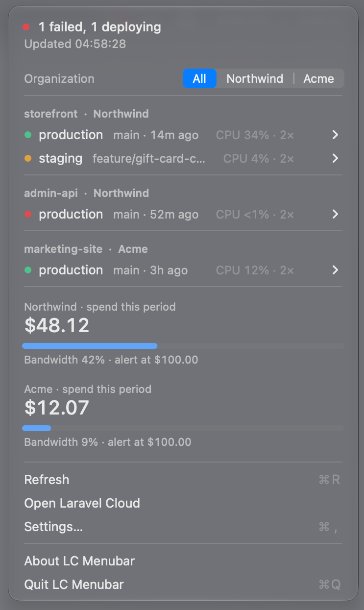
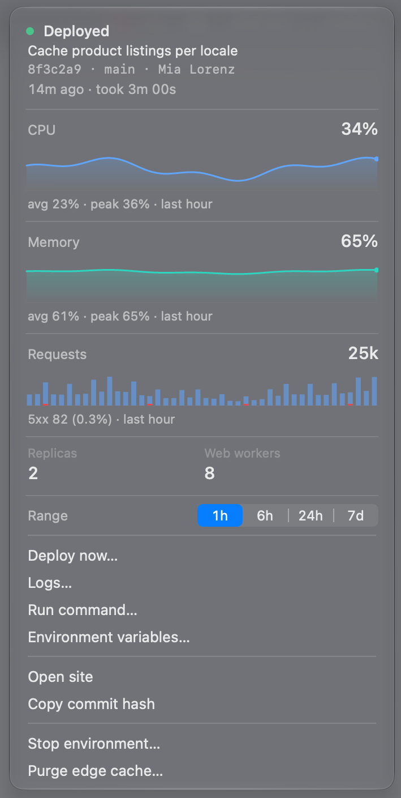
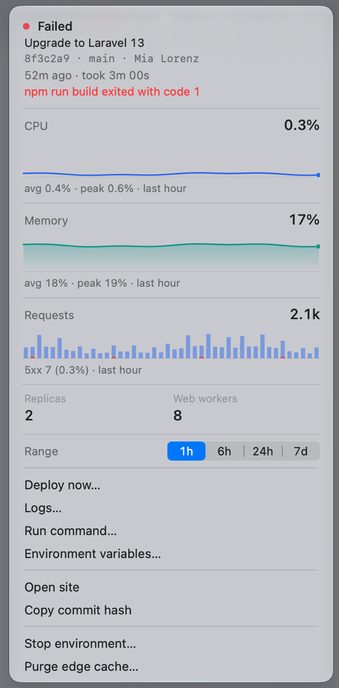
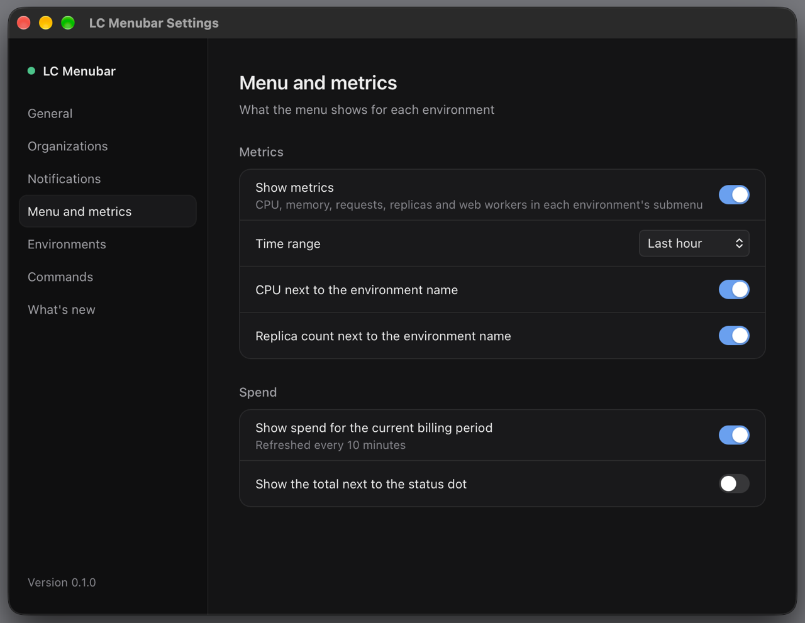
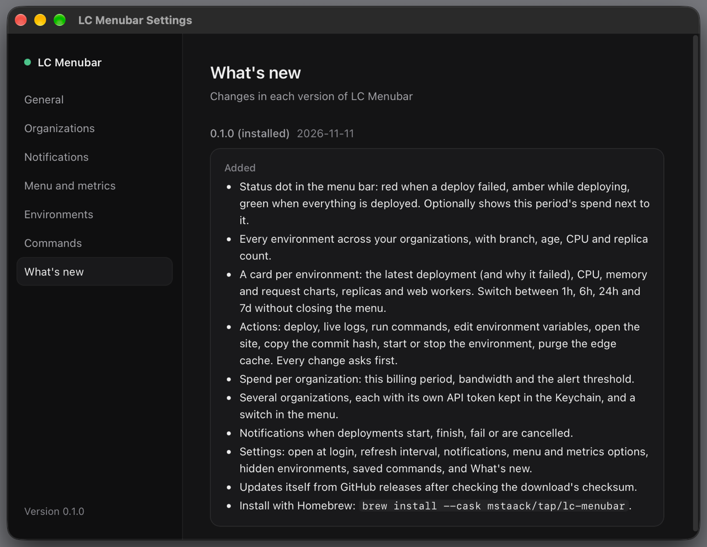

# LC Menubar

[Laravel Cloud](https://cloud.laravel.com) in your macOS menu bar: deployment status, metrics, spend and quick actions.

> 🤖 **100% vibe-coded.** Every line was written by [Claude](https://claude.ai) (Claude Code). Use accordingly.

## Install

```sh
brew install --cask mstaack/tap/lc-menubar
```

Then paste a Laravel Cloud API token in Settings › Organizations. Tokens live in the Keychain. The app updates itself. macOS 13+, Apple silicon and Intel.

<details>
<summary>Without Homebrew</summary>

Download the zip from the [latest release](https://github.com/mstaack/lc-menubar/releases/latest) and move `LC Menubar.app` to Applications. The app isn't notarized yet, so clear the download flag once before opening it:

```sh
xattr -dr com.apple.quarantine "/Applications/LC Menubar.app"
```
</details>

## Features

- Status dot in the menu bar: failed, deploying, deployed
- All environments across organizations, with branch, age and CPU
- Per-environment cards: latest deploy, CPU/memory/request charts (1h–7d)
- Actions: deploy, logs, run commands, edit env vars, start/stop, purge cache
- Spend and bandwidth per organization
- Deployment notifications

## Screenshots

<table>
  <tr>
    <td align="center" valign="top" width="33%"><br><sub>Environments and spend</sub></td>
    <td align="center" valign="top" width="33%"><br><sub>Environment card</sub></td>
    <td align="center" valign="top" width="33%"><br><sub>A failed deploy, light mode</sub></td>
  </tr>
</table>

<table>
  <tr>
    <td align="center" valign="top" width="50%"><br><sub>Settings</sub></td>
    <td align="center" valign="top" width="50%"><br><sub>What's new</sub></td>
  </tr>
</table>

---

Not affiliated with Laravel Holdings Inc. MIT licensed.
